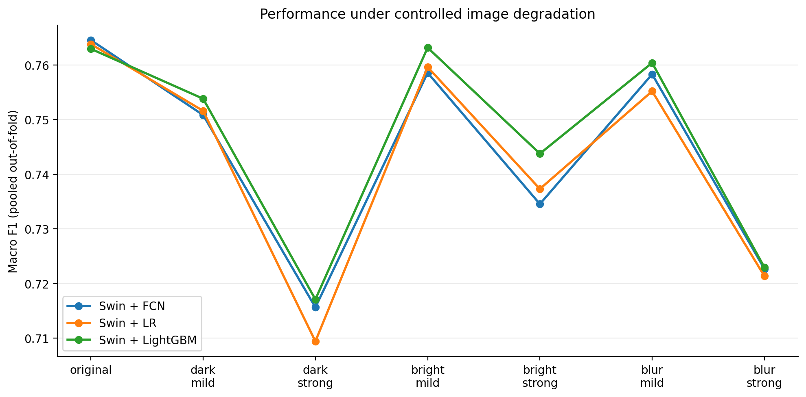
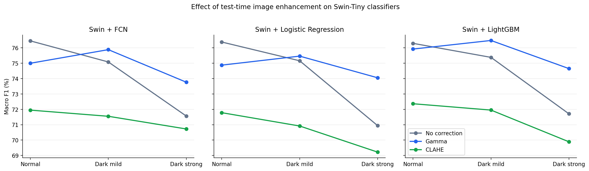
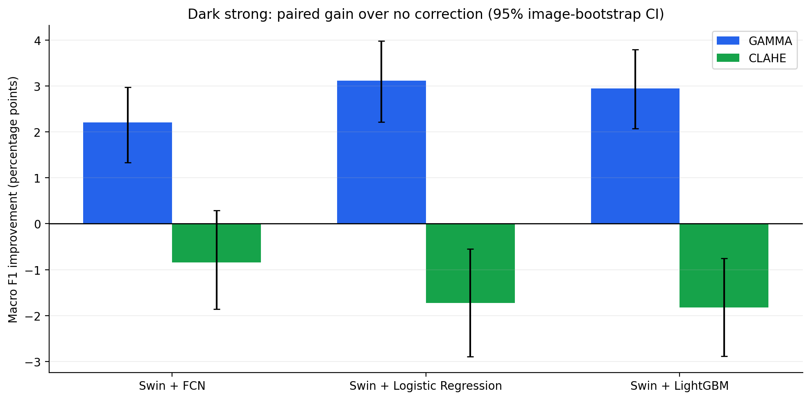

# Results summary and interpretation

Numerical results below reproduce saved project outputs, not a new training run. Both experiments use matched held-out fold predictions on **4,390** FFE images.

## Experiment 08 — synthetic robustness

| Condition | FCN Macro F1 | LR Macro F1 | LightGBM Macro F1 |
|---|---:|---:|---:|
| Original | 0.7645 | 0.7638 | 0.7629 |
| Dark mild (×0.8) | 0.7508 | 0.7516 | 0.7538 |
| Dark strong (×0.6) | 0.7157 | 0.7094 | 0.7171 |
| Bright mild (×1.2) | 0.7586 | 0.7596 | 0.7632 |
| Bright strong (×1.4) | 0.7346 | 0.7373 | 0.7438 |
| Blur mild (σ0.7) | 0.7583 | 0.7552 | 0.7604 |
| Blur strong (σ1.5) | 0.7227 | 0.7214 | 0.7230 |

The strongest darkening and blur substantially reduced all three models' Macro F1. Small between-head differences are not universally statistically distinguishable.

## Experiment 09 — enhancement, selected on validation folds

| Condition | Method | FCN | LR | LightGBM |
|---|---|---:|---:|---:|
| Original | None | 0.7645 | 0.7638 | 0.7629 |
| Original | Gamma | 0.7500 | 0.7488 | 0.7592 |
| Original | CLAHE | 0.7195 | 0.7178 | 0.7237 |
| Dark mild | None | 0.7508 | 0.7516 | 0.7538 |
| Dark mild | Gamma | 0.7588 | 0.7546 | 0.7648 |
| Dark mild | CLAHE | 0.7155 | 0.7092 | 0.7195 |
| Dark strong | None | 0.7157 | 0.7094 | 0.7171 |
| Dark strong | Gamma | 0.7377 | 0.7405 | 0.7465 |
| Dark strong | CLAHE | 0.7072 | 0.6922 | 0.6989 |

On severe synthetic darkening, gains in Macro F1 from Gamma vs no correction were **+0.0220 FCN**, **+0.0311 LR**, **+0.0294 LightGBM**. The paired image-bootstrap 95% intervals for those differences were respectively `[+0.0133, +0.0297]`, `[+0.0221, +0.0398]`, and `[+0.0207, +0.0380]`.

## Not Fresh → Highly Fresh misclassification counts, severe darkening

| Model | No correction | Gamma | CLAHE |
|---|---:|---:|---:|
| FCN | 74 | 54 | 112 |
| LR | 95 | 69 | 155 |
| LightGBM | 92 | 65 | 152 |

These counts are one error type, not total classification risk. More importantly, class labels use day-of-storage groupings and should not be construed as food safety verification.

## Practical interpretation

- On synthetic darkening, gamma correction can recover some of the lost predictive performance without retraining the model.
- CLAHE degraded Macro F1 for the tested parameterization.
- Applying Gamma correction to original, undarkened images can reduce Macro F1, so blanket enhancement is not recommended.
- Results do **not** prove that a camera-time darkness detector or a conditional automated enhancement policy works; such a system was not tested.
- Exploratory, in-dataset validation is not an external acquisition benchmark; specimen/session leakage and multiple-testing concerns remain.

### Charts

